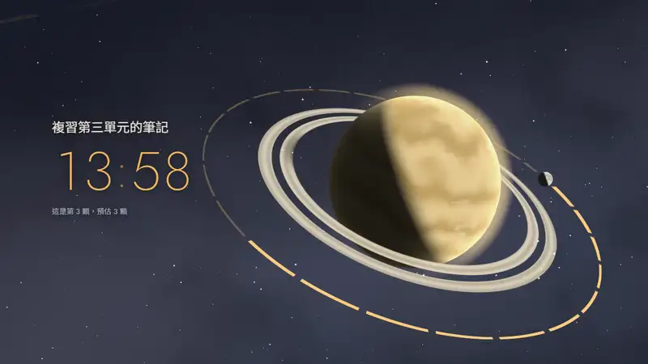

# 近日點 Perihelion

**把今天要做的事，變成一個繞著太陽轉的星系。**

A Pomodoro timer where today's tasks orbit a sun: the more urgent, the closer in, and each planet lights up as you focus on it.



多數番茄鐘是在待辦清單旁邊放一個計時器。近日點把兩者合成同一個畫面，優先度、預估量、進度、完成紀錄都用星系裡的空間關係來表達：

- **待辦是行星。** 越急的事，軌道越靠近太陽；預估要花越多顆番茄，行星越大。拖動行星往太陽靠，就是把它往前排。
- **專注，是看一顆行星亮起來。** 開始計時後畫面拉近到那顆行星，它從一彎新月慢慢亮成整顆，亮滿了就是一顆番茄。繞著它的月亮是分針（繞一圈是一顆番茄），行星自轉是秒針（轉一圈是一分鐘）。
- **做完的事升上天空。** 同一天完成的待辦連成一個星座，游標靠近會列出那天做了什麼。
- **為了整晚開著而設計。** 沒有後製、沒有陰影貼圖，更新率依情境調整：專注中每秒 20 幀，分頁隱藏時完全不畫。
- **只有一個檔案。** 建置出來是單一的 `index.html`，雙擊就能開。不需要伺服器、帳號或網路，資料只存在你自己的瀏覽器裡。

## 試試看

**線上版：<https://sylvia-h.github.io/perihelion/>**

第一次打開是空的星系。想先看有資料的樣子，開這幾個示範：

| 連結 | 看到什麼 |
|---|---|
| [俯瞰星系](https://sylvia-h.github.io/perihelion/?demo=overview) | 六件待辦、五天的星座、今天的番茄紀錄 |
| [專注中](https://sylvia-h.github.io/perihelion/?demo=focus) | 專注到一半的畫面 |
| [休息中](https://sylvia-h.github.io/perihelion/?demo=break) | 休息中的畫面 |

示範模式不讀也不寫你的資料。

線上版的資料一樣只存在你的瀏覽器裡，不會傳到任何地方。

### 在自己的電腦上開

```
git clone https://github.com/sylvia-H/perihelion.git
cd perihelion
npm install
npm run build
```

然後雙擊 `dist/index.html`，不需要 server 也不需要網路。建議把它釘選成瀏覽器分頁。示範模式在本機同樣可用：在網址後面加 `?demo=overview`、`?demo=focus` 或 `?demo=break`。


## 畫面上每樣東西代表什麼

| 畫面 | 資料 |
|---|---|
| 軌道離太陽多近 | 優先度。清單越上面越靠內圈 |
| 行星大小 | 預估番茄數 |
| 行星環 | 已完成的番茄數，一顆一道 |
| 虛線軌道／實線軌道 | 還沒動過／至少做過一顆 |
| 環繞太陽的弧 | 計時進度（俯瞰時） |
| 行星的明暗 | 計時進度（專注時），從彎月到整顆亮起來就是一顆番茄 |
| 繞著行星的月亮 | 分針（專注時）：繞一圈是一顆番茄，會繞到行星背後再出來；軌道一分鐘一段，走過的段會亮。按 `B` 可以換軌道的樣式 |
| 行星的自轉 | 秒針（專注時）：轉一圈是一分鐘；暫停時月亮與自轉都停住 |
| 外圈刻度盤 | 一天 24 小時；橘色的弧是今天每顆番茄的起訖，白線是現在 |
| 天上的星座 | 一天做完的待辦；游標靠近會列出那天做了什麼 |
| 右下角的圓點 | 今天的容量：做完的、還排著的、排不進今天的 |

## 月曆：先排之後的事

點左上角的日期（或按 `C`）打開月曆。每一格下面的實心數字是那天做完的番茄數，空心數字是排著的待辦數。

| 點哪一天 | 看到什麼 |
|---|---|
| 今天 | 平常的畫面 |
| 之後的某一天 | 那一天的軌道。在下方輸入就會排到那一天，也可以拖曳排序、調預估。到了那天它們會自動出現 |
| 過去的某一天 | 那天做完了哪些事、幾顆番茄，刻度盤上是那天每顆番茄的時段。只能看 |

- 排在某一天卻沒做完的待辦不會留在過去：隔天它會自動出現在「今天」。
- 今天的待辦可以按「明天再做」；排在之後的可以按「移到今天」。
- 專注中不能切到別天。

## 操作

| 按鍵 | 動作 |
|---|---|
| `N` | 輸入新的待辦。結尾加 `×3` 是預估三顆，加 `!` 排到最內圈 |
| `Space` | 開始專注、暫停、繼續 |
| `↑` `↓` | 選上一件、下一件；加 `Alt` 是往內圈、外圈移 |
| `D` | 選取的待辦做完了 |
| `+` `−` | 預估番茄數加減一顆 |
| `Del` | 刪除選取的待辦 |
| `Esc` | 專注時在「行星」與「整個星系」之間切換 |
| `←` `→` | 轉動星系；`0` 回到預設視角 |
| `B` | 切換月亮軌道的樣式：細線、清透琉璃、細線加光暈 |
| `S` | 略過休息 |
| `C` | 月曆。`[` `]` 是前一天、後一天，`T` 回到今天 |
| `L` | 紀錄與設定（今日紀錄、十四天長條圖、時間長度、匯出匯入） |
| `M` | 提示音開關 |
| `F` | 顯示目前的更新率與解析度 |
| `Ctrl` `Z` | 復原上一次的完成或刪除 |
| `?` | 鍵盤操作說明 |

滑鼠：按住空白處拖曳是轉動星系（左右繞圈、上下改俯角，放手有慣性），連點兩下回到預設視角。
專注時按住拖曳是繞著那顆行星上下左右看：月亮或亮段被行星擋住時，轉一下就看得到。
按在行星上拖曳是改優先度：拉近太陽就是往前排。左側的待辦列也可以上下拖曳排序。

## 為什麼可以整晚開著

| 做法 | 省到什麼 |
|---|---|
| 星雲在啟動時烤成一張立方體貼圖 | 全螢幕的雜訊運算只做一次，之後每幀只是取樣 |
| 沒有後製、沒有陰影貼圖 | 光暈是加色面片，行星環上的影子在 shader 裡直接算 |
| 依情境切換更新率 | 操作中 60、靜置 30、專注中 20、視窗失焦 12、分頁隱藏 0 |
| 連續掉幀時自動降解析度 | 內顯撐不住時畫面變糊一點，而不是變卡 |
| 計時用時間戳，不數畫面更新次數 | 分頁在背景、電腦睡眠都不會走慢 |
| 計時的心跳放在 Web Worker | 背景分頁的計時器會被瀏覽器壓到一分鐘一次，Worker 不會 |
| 介面不用 `backdrop-filter` | 在持續重繪的畫布上做模糊是內顯最貴的事之一 |

設定裡另有「省電畫質」：關掉大氣光暈、降低解析度與表面細節。

## 資料

存在瀏覽器的 localStorage，鍵名 `perihelion.v1`。清除瀏覽資料會一併清掉，可以在「紀錄與設定」匯出備份。
頁面關掉期間計時器照樣在走：重新開啟時，該結束的番茄會補記。

資料量：一件待辦約 150 bytes。每天排 10 件、連用一年約 0.5MB，瀏覽器給每個頁面約 5MB。
超過 400 天的已完成待辦與紀錄會在開啟時自動清掉；還沒做完的待辦永遠不會被清。

以 `file://` 開啟時瀏覽器不給系統通知，所以番茄結束的提示是：提示音、分頁標題的倒數、分頁圖示（一顆由暗轉亮的小行星）。

## 開發

```
npm install
npm run dev        # 開發伺服器
npm test           # 邏輯層測試（Node 內建測試執行器，直接跑 TypeScript）
npm run build      # 型別檢查後建置成 dist/index.html
npm run smoke      # 用真的滑鼠鍵盤事件操作建置結果（需要本機有 Chrome）
```

| 位置 | 內容 |
|---|---|
| `src/core/` | 資料模型、計時、狀態轉移、統計、軌道幾何。純函式，不碰 DOM 與 three.js，測試在這裡 |
| `src/scene/` | three.js 場景與全部 GLSL。只讀狀態，透過回呼回報操作 |
| `src/ui.ts` | DOM 介面，沒有框架 |
| `src/main.ts` | 把以上接起來：儲存、計時心跳、提示音、分頁標題與圖示 |
| `PRODUCT.md` | 這個產品是什麼、給誰用、硬限制 |

要換視覺風格，改 `src/scene/scene.ts` 的 `RECIPES`（行星配色）、`src/scene/shaders.ts`（材質）與 `src/style.css` 開頭的色票即可，邏輯層不用動。
